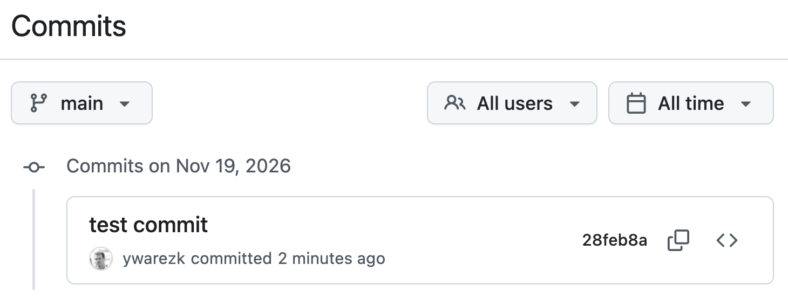
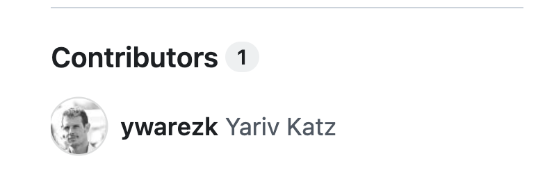
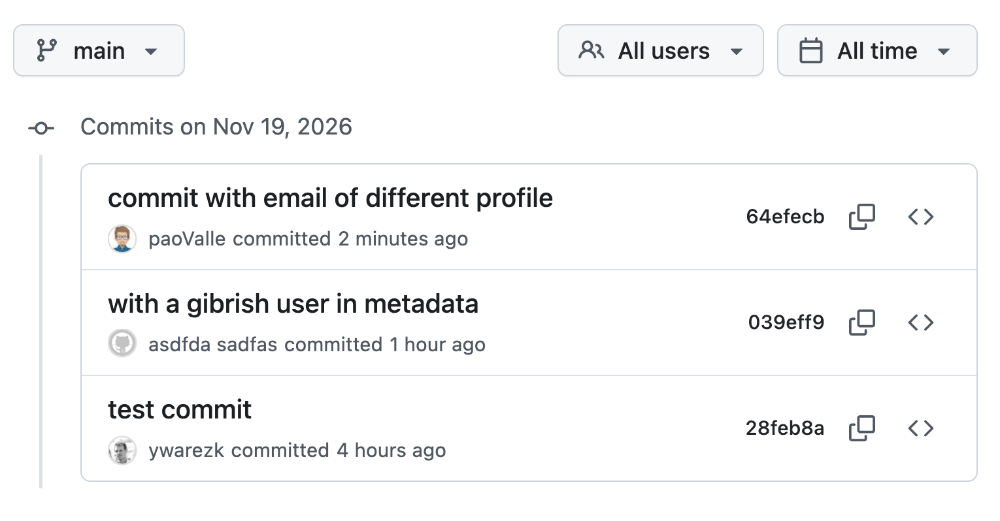
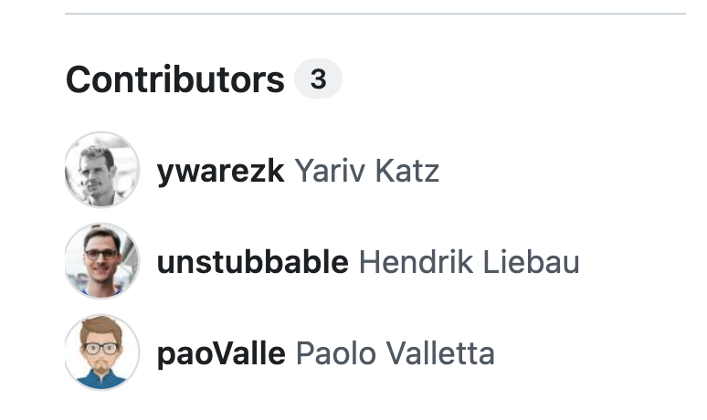
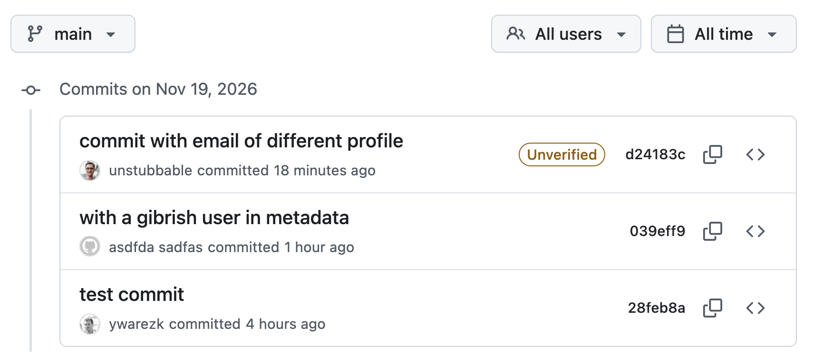

## Most developers get at least one of these wrong

This lesson is about which email address lands in Git commit metadata on public GitHub work. **Most developers are doing at least one of these things wrong.** If you recognize yourself below, the **fix** under each item is what we recommend; the sections that follow explain **why**.

1. **You still push with a real inbox (or any verified private address on your account) in `user.email`.**  
   **Fix:** Copy your GitHub no-reply address from [Settings → Emails](https://github.com/settings/emails)—it looks like `2714362+username@users.noreply.github.com` (numeric ID, `+`, username, `@users.noreply.github.com`). Use that in Git, not your work or personal address.

2. **GitHub email privacy is off, or only half on.**  
   **Fix:** On [Settings → Emails](https://github.com/settings/emails), enable **Keep my email addresses private**. That reveals **Block command line pushes that expose my email**—turn that on too. With blocking enabled, GitHub rejects a push when the latest commit uses a verified private address on your account. Until you set `git config user.email` to that noreply address (typically with `git config --global user.email`), those pushes stay rejected.

:::note
If you deliberately want your real inbox in commit metadata—for example so collaborators can email you from `git log`—set a local `git config user.email` to a verified address on your account. That conflicts with blocking: turn **off** **Block command line pushes that expose my email** for the whole account (there is no per-repository exception). Your address is back in history for any GitHub repo you push to with that config.
:::

3. **Your browser is safe but local Git is not.**  
   Privacy settings help for web-based commits; pushes from your machine still use `git config`. If you turned on **Keep my email addresses private** and **Block command line pushes that expose my email**, GitHub rejects pushes from local Git until the author email on the commit is your noreply—not a verified private address on your account.  
   **Fix:** Point Git at that no-reply address globally:

```bash
git config --global user.email "ID+username@users.noreply.github.com"
```

Replace the placeholder with the exact address GitHub shows on [Settings → Emails](https://github.com/settings/emails). Check per-repo settings too: `git config user.email` overrides global config inside that repository.

**Part of our best-practice recommendations** (later lessons in this course):

- Create a GPG key whose email identity is your GitHub noreply address, configure Git to sign commits, and add the public key to GitHub.
- Add a ruleset (organization or repository) with **Require signed commits**—GitHub enforces **verified** signatures, so unsigned and **Unverified** commits are rejected.
- Enable [vigilant mode](https://docs.github.com/en/authentication/managing-commit-signature-verification/displaying-verification-statuses-for-all-of-your-commits) on your account so unsigned or unverified commits show that status instead of looking fully trusted.

We explain those in a future lesson.

The rest of the lesson explains **why** each fix matters. We start with the problem.

## Email is exposed for everyone to see

I enjoy my privacy and prefer to keep my email private. To show why that matters, we clone a popular open source project: [ohmyzsh/ohmyzsh](https://github.com/ohmyzsh/ohmyzsh).

```bash
git clone https://github.com/ohmyzsh/ohmyzsh.git
cd ohmyzsh
```

Anyone who clones the repo gets the full commit history. We can read the metadata Git stored with each commit using `git show`. The `-s` flag skips the patch; `--format=fuller` prints **Author** and **Committer** (with dates).

```bash
git show -s --format=fuller HEAD~4
```

I tried `HEAD` first, but many recent commits on this repo already use GitHub’s no-reply email—the fix from this lesson. Stepping back a few commits (`HEAD~4`) still shows a real address on the **Author** line:

```
commit 6010fb6260f359e71d99ba25f05f9215809b3ed2
Author:     Pa***** Val***** <pao******@hotmail.it>
AuthorDate: Mon Nov 9 13:36:11 2026 +0100
Commit:     GitHub <noreply@github.com>
CommitDate: Mon Nov 9 13:36:11 2026 +0100

    fix(mvn): complete with compsys instead of compctl (#14241)
```

In this write-up we redact the name and email with `*`. On your machine, after `git clone`, you see the full **Author** name and email—whatever was in that contributor’s `git config` when they made the commit.

Notice **Commit** is `GitHub <noreply@github.com>` (typical for a merged PR) while **Author** can still be a personal address. GitHub’s web UI does not remove the author email from Git history; it stays in the object anyone can read.

## Recommendation: do not expose your email address in public commit metadata

Your email in a commit is not “just metadata.” On a **public repository**, it is exposed for everyone to see—it rides along with the code forever.

Git does not forget. Once your real address is in history, it stays in the object database for anyone who clones or forks the repo. Deleting a branch or making the repository private on GitHub does not erase commits that already spread to other clones and mirrors. You can rewrite history in a repo you control, but you cannot take back what people already copied.

That visibility invites abuse that has nothing to do with open source itself:

- **Scraping** — Scripts walk public repos and collect author emails for mailing lists.
- **Spam and phishing** — A work or personal address tied to your public open-source activity is an easy target (“your PR was merged,” “CVE in your library”).
- **Correlation** — The same email can link your GitHub identity to employer accounts, gravatar, old projects, or breach dumps.
- **Unwanted contact** — You may be fine with issues and discussions; you may not want strangers emailing you directly because they found you in `git log`.

GitHub’s profile page might hide your email, but **the clone does not**. `git log` and `git show` are enough. That gap is exactly what we showed with ohmyzsh.

So our recommendation is simple: for public work, **do not put your real inbox in `user.email`**. Use an address meant to be public—GitHub’s no-reply email is built for that—and turn on the settings that keep your verified email off commits when you use the website. In the next sections we configure Git and GitHub that way.

Let's examine a few solutions to our problem.

## Unused mail

We could always register yet another email address and use it only for commits…

Your GitHub account can hold multiple verified addresses. The idea is simple: open a mailbox you do not care about, add it to GitHub, and set `git config user.email` to that address. Whatever lands in the **Author** line is still copied into every clone forever—scrapers do not care that it is a “junk” inbox. You accept spam and phishing there; mail from other developers can show up too, and most people just ignore it.

That trades one problem for another. You are still publishing a routable address in public Git history. You also take on another mailbox to verify and maintain. GitHub **cannot** verify disposable email providers—you need a real inbox you can confirm ([email verification restrictions](https://docs.github.com/en/account-and-profile/reference/email-addresses-reference)). Every address you add to your account must be verified before GitHub treats it as yours for commits on your profile.

It also fights the setup we walk through later in this lesson. If you turn on **Keep my email addresses private** and **Block command line pushes that expose my email** (the second option appears after you enable privacy), GitHub rejects pushes when the latest commit author is a **private email on your account**—any verified address tied to you, including a dedicated “commits only” inbox, not only your main address. With that protection on, pushing successfully means using GitHub’s supported approach in the following sections—not keeping a spare address in `user.email`.

Without blocking enabled, you can still push with the throwaway and keep your main inbox off commits—until a wrong `user.email` on another machine or in a single repo slips through. Blocking is there to catch that mistake; a throwaway inbox is not the same kind of safety net when you also want commits linked to your GitHub account.

For any **public repository**—code anyone can clone and read with `git log`—we treat this as a weak workaround.

## Placing a "wrong" email

The email and name we saw in the example can be easily changed with the `git config user.email "some@email.academeez"` and `git config user.name "Academeez Rulezzzz"` (The `--global` flag is also important here and we will give recommendations regarding that flag later on).
Those commands will change the commit metadata.
So the question is, if I don't want my mail exposed I could simply set the name and email to be false values.

So you could set `git config user.email "not-my@real.email"`

That shortcut still “works” in Git, but on GitHub it runs into separate problems: profile linking, commit verification, and branch rules that enforce verified signatures. We walk through all three with the same small experiment.

### Commits are connected to profiles

GitHub—and other sites that host Git repositories—link a commit to a user profile by matching the **Author** email in commit metadata to a **verified email on a GitHub account**—the address you signed up with or any address you added under [Settings → Emails](https://github.com/settings/emails). GitHub can also attribute people listed in **`Co-authored-by:`** trailers in the commit message; see [Creating a commit with multiple authors](https://docs.github.com/en/pull-requests/how-tos/commit-changes/creating-a-commit-with-multiple-authors).

Here is a simple experiment to see what happens when `git config user.email` does not match what you expect. We use the remote repository [Nerdeez/github-noreply-email](https://github.com/Nerdeez/github-noreply-email); you can inspect the commits there.

For the first commit we use a mailbox connected to my profile (a dedicated address for this lesson). I created a new folder, ran `git init`, and pointed `origin` at that repository on GitHub.

```bash
mkdir github-noreply-email
cd github-noreply-email
git init
git remote add origin https://github.com/Nerdeez/github-noreply-email.git
git branch -M main
```

Our first commit for this repository uses a dedicated mailbox connected to my GitHub account—an address I do not mind exposing for this demo (I removed it from the account after the lesson). I set local Git to that address:

```bash
git config user.email "*****@*****.com"
```

We then created a `README.md` with some text and pushed our first commit to produce a normal commit with an exposed email (which we do not recommend for everyday work).

We can now examine the [remote commits](https://github.com/Nerdeez/github-noreply-email/commits/main/) and we will see one commit that is created with our user profile:



Notice in the image that my GitHub avatar appears: GitHub matched the author email to my account.

We can also open **Contributors** and see my profile listed for this repository:



Now let's see what happens if I give a mail that is not connected to anything:

```bash
git config user.email "non-existing-address@academeez.com"
```

We changed `README.md` again, committed, and pushed. The new commit is **not** linked to any GitHub profile—the author email is not on anyone’s account.

In this experiment the **Contributors** list did not change; GitHub still showed only one contributor.

One more experiment: we misbehave a bit and set `user.email` to an address we know belongs to someone else’s GitHub account—we took it from a contributor in ohmyzsh (you can lift author emails from public `git log` output on many projects).

```bash
git config user.email "existing-profile@but-not.mine"
```

We create another commit and push. On the commits page the UI may attribute the commit to their profile—it can look like that person contributed:



That happens when the **author email** matches their account; it does not always add them everywhere GitHub surfaces contributors. That does **not** mean they logged in or approved the push—you still pushed with **your** credentials; only the **metadata** claims to be them. (`git config user.name` is just as easy to fake.)

Also notice what **Contributors** may show for our repository now:



In our demo, playing with `git config user.email` pushed the **Contributors** count to 3 on that repo—what you see can differ, and GitHub may not treat every forged-author commit as a new contributor in every view.

### Wrong author email cannot be verified

Profile linking is only one axis. Later lessons cover **commit signing** in depth; for this demo, the important part is what GitHub shows on the commit.

GitHub awards a **Verified** badge only when the signature checks out, you have signing set up, and the signing key is on your account **and** aligned with the **Author** email. You can still *create* commits with a random or forged author email, but they stay **unsigned**, or **Unverified** if you sign with your key while `user.email` does not match the emails on that key and your GitHub account.

Even if you sign the ohmyzsh-style commits with **your** key, GitHub will not show **Verified** for the reasons above—a “wrong” `user.email` (random, unused, or borrowed from someone else) cannot become a verified commit on your identity.

On your own account, [vigilant mode](https://docs.github.com/en/authentication/managing-commit-signature-verification/displaying-verification-statuses-for-all-of-your-commits) makes that gap visible: it marks commits that are unsigned or not fully verified instead of hiding them:



Signing and vigilant mode deserve their own lesson. For now: treat author name and email in Git as claims anyone with push access can forge—do not trust a commit just because GitHub shows an avatar unless it carries a **Verified** signature you expect.

### Rulesets reject unsigned and unverified commits

In our experiment every push still succeeded—Git does not block odd metadata. Organizations and repositories can tighten that with a ruleset rule **Require signed commits**; GitHub enforces **verified** signatures, not merely an attached signature.

Once that rule applies to the branches you push to, commits that are **unsigned** or **Unverified**—including everything we made with a wrong `user.email`—are rejected on push or merge. That is not Git forbidding the email; the commit simply fails the rule.

## GitHub private email

Let's go back to the email settings at [Settings → Emails](https://github.com/settings/emails). At the bottom of the screen there is an interesting option we recommend turning on: **Keep my email addresses private**.

The explanation on this option (quoted from GitHub):

> We’ll remove your public profile email and use your GitHub no-reply address (`ID+username@users.noreply.github.com`) when performing web-based Git operations (e.g. edits and merges) and sending email on your behalf. If you want command line Git operations to use your private email you must set your email in Git.
>
> Previously authored commits associated with a public email will remain public.

On that same page GitHub shows your account’s noreply address—the special `ID+username@users.noreply.github.com` mail GitHub provides so commits can link to your profile without exposing a real inbox. We recommend copying the exact address from **Settings → Emails** and setting it in `git config user.email` for local Git—for example with `git config --global user.email "…"`. GitHub applies noreply for you on the website when privacy is on; your local Git does not switch unless you configure it.

Web-based operations are commit changes you make on the website—popular examples are merging a pull request or editing a file in the browser. In those cases, new commits use your GitHub noreply email. That setting does not change commits you push from your computer; those still use the address from `git config user.email`.

When you turn on **Keep my email addresses private**, another option appears. We recommend turning that on too: **Block command line pushes that expose my email**. GitHub describes it like this:

> When you push to GitHub, we'll check the most recent commit. If the author email on that commit is a private email on your GitHub account, we will block the push and warn you about exposing your private email.

This is extra protection: GitHub blocks the push when the author email on the commit it checks is a verified address on your account that you are trying to keep private—not your noreply address. Treat it as a safety net when you forget to fix `user.email`, not something that rewrites old history. Blocking protects your verified emails from that kind of mistake; it does **not** protect the repository from forged author metadata—that is what signing, rulesets, and vigilant mode are for.

That check applies to the **Author** email on the commit GitHub inspects only—not to every address in **`Co-authored-by:`** trailers. If you list co-authors, use noreply or other addresses you intend to expose there too; see [Creating a commit with multiple authors](https://docs.github.com/en/pull-requests/how-tos/commit-changes/creating-a-commit-with-multiple-authors).

Another extra protection—we will cover this in a future lesson—is signed commits. **Verified** on GitHub means the signature checks out and the key is on your account; a later lesson covers GitHub’s email and key matching rules in full. A GPG key is tied to an email address; we will create one for your GitHub noreply address, turn on signing in `git config`, and use rules on the remote so unsigned or **Unverified** commits cannot land. That proves the commit came from you and gives you another check that commit metadata uses the noreply GitHub mail—not a verified private address by mistake.

In some cases—personally, it has not happened to me—you may want a verified address on your account in commit metadata. For example, you contribute to a private repository and maintainers ask you to leave a reachable email for questions about a certain commit. Then you set `git config user.email` to that address and turn **off** **Block command line pushes that expose my email** for the whole account (there is no per-repository exception).

If you keep the recommended settings turned on, you still need to adjust Git before you push—otherwise your next push to the remote might be rejected.

## user.email configuration

As mentioned earlier, GitHub matches the **Author** email in commit metadata, and **`Co-authored-by:`** trailers in the message, to accounts ([Creating a commit with multiple authors](https://docs.github.com/en/pull-requests/how-tos/commit-changes/creating-a-commit-with-multiple-authors))—so one commit can connect to more than one profile when co-authors are listed.

The GitHub noreply address—the `ID+username@users.noreply.github.com` form on [Settings → Emails](https://github.com/settings/emails)—is tied to your profile too. If you push with `git config user.email` set to that address, you stay associated with the commit while your real inbox stays hidden from nosy snooping. With **Block command line pushes that expose my email** on, GitHub still allows pushes when the **Author** line uses noreply—that is why we recommend it as your global default:

```bash
git config --global user.email "ID+username@users.noreply.github.com"
```

`--global` makes that address the default that applies to every repository on this machine. You can override it in one repo by `cd` into that project and setting a **local** value (no `--global`):

```bash
cd git-repo-with-different-email
git config user.email "some-other@mail-then.default"
```

If that local address is a verified email on your GitHub account, you will have to turn **off** **Block command line pushes that expose my email** on [Settings → Emails](https://github.com/settings/emails) for the whole account (there is no per-repository exception).

## Summary

Every commit stores **Author** name and email in Git history. Anyone who clones a public repository can read them with `git log` or `git show`—even when GitHub’s website hides your address. A disposable inbox or a fake `user.email` are weak fixes: you still leak a routable address, fight GitHub’s privacy settings, or let commit metadata impersonate another profile without real authentication.

**Our recommendation for public work on GitHub:**

1. Copy your GitHub no-reply address from [Settings → Emails](https://github.com/settings/emails) (`ID+username@users.noreply.github.com`).
2. Turn on **Keep my email addresses private**, then **Block command line pushes that expose my email**.
3. Set `git config --global user.email` to that noreply address (override per repo only when you mean to).

Optional: if you deliberately want a verified address on your account in metadata—for example so maintainers can email you from `git log`—use a local `git config user.email` and turn blocking **off** for the whole account; your inbox is back in history for any push that uses that config.

**Also part of our best-practice recommendations** (covered in later lessons in this course):

- Create a GPG key whose email identity is your GitHub noreply address, configure Git to sign commits, and add the public key to GitHub.
- Add a ruleset (organization or repository) with **Require signed commits**—GitHub enforces **verified** signatures, so unsigned and **Unverified** commits are rejected.
- Enable [vigilant mode](https://docs.github.com/en/authentication/managing-commit-signature-verification/displaying-verification-statuses-for-all-of-your-commits) so unsigned or unverified commits are visible instead of looking fully trusted.

Noreply plus privacy and blocking gives you profile-linked commits without exposing your real inbox. Signing, rulesets, and vigilant mode close the gap between “metadata says who you are” and “we can trust who actually made the commit.”


